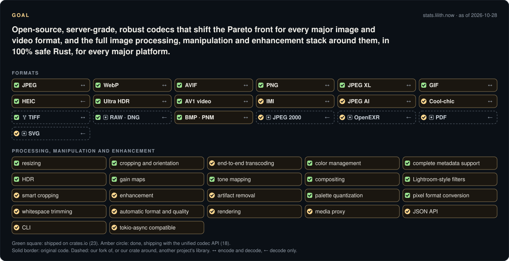
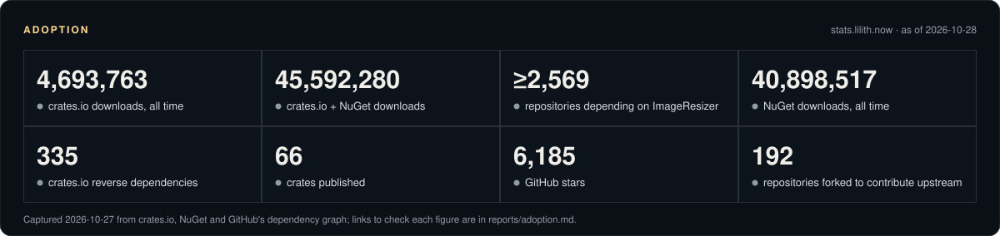
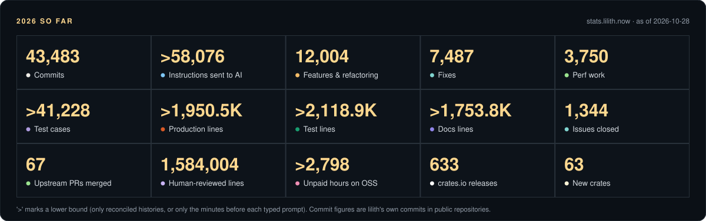
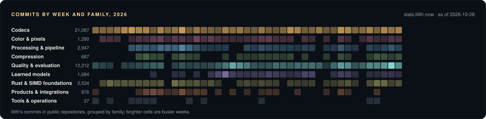
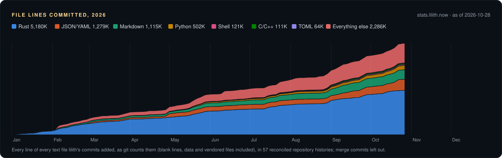

# awesome

Lilith River's open-source imaging work, in one place: what it is for, what is done, who depends on it, and how it is built. Live numbers: **[stats.lilith.now](https://stats.lilith.now/)**.

| | | |
|:--|:--|:--|
| **Codecs** encode and decode, in safe Rust | [zenjpeg] · **[zenpng]** · **[zenwebp]** · [zengif] · [zenavif] · [zenjxl] · [zenjxl-decoder] · **[jxl-encoder]** · [zenbitmaps] · **[heic]** · [zentiff] · [zenpdf] · [zensvg] · [zenjp2] · [zenraw] · [ultrahdr] · [zenjpegai] · **[mozjpeg-rs]** · **[webpx]** · [evif] · [zenjpeg-dispatch] · [zencoolchic] · [codec-design] · [gainmap-spec-status] · [jxl-inspect] | 22 repos · 14 on crates.io · 13,803 commits |
| **AV1 and codec internals** the AV1 encoders, decoder and containers under AVIF | [zenrav1e] · [rav1d-safe] · [zenravif] · [zenavif-parse] · [zenavif-serialize] · [zenav1-svt] · [zenav1-aom] · [jxl-gpu] | 7 repos · 4 on crates.io · 7,694 commits |
| **Processing** resize, quantize, blend, tone-map, enhance | **[zenresize]** · [zenquant] · **[zenblend]** · [zenfilters] · [zensally] · **[zentone]** · [zensr] · [quantizr] | 8 repos · 5 on crates.io · 3,017 commits |
| **Pixels & color** pixel formats, transfer functions, color | **[zenpixels]** · **[zenpixels-convert]** · **[linear-srgb]** · **[garb]** · **[zenyuv]** · [oxcms] · [cms-bench] · [imagetones] · [BRAG] | 8 repos · 5 on crates.io · 4,231 commits |
| **Pipeline & framework** streaming pipeline, codec traits, layout | [zenpipe] · **[zencodec]** · [zencodecs] · [zenlayout] · [zennode] · [zenwasm] · [zentract] | 5 repos · 3 on crates.io · 2,818 commits |
| **Compression** DEFLATE, Zopfli, Zstandard | **[zenflate]** · [zenzop] · [zenzstd] · [zenhash] | 4 repos · 2 on crates.io · 687 commits |
| **Psychovisual metrics** perceptual quality, to tune the codecs | [zensim] · **[fast-ssim2]** · **[butteraugli]** · [zenmetrics] · [resamplescope-rs] · [squintly] · [codec-eval] | 7 repos · 5 on crates.io · 11,866 commits |
| **Pickers & ML** the right codec and quality per image | [zenanalyze] · [zenpredict] · [zenpicker] · [zenanalyze-api] | 1 repo · 2 on crates.io · 1,365 commits |
| **Test corpora** images to test and train on | **[codec-corpus]** · [imazen-26] · [all-the-images] · [zentrain-corpus] · [imazen-26-jxl-p3] · [imazen-26-originals] · [imazen-26-jxl-srgb] · [imazen-xl-26] · [mozjpeg-test-references] | 9 repos · 1 on crates.io · 342 commits |
| **SIMD & Rust foundations** safe SIMD, cancellation, errors, benchmarks | **[zenbench]** · **[archmage]** · **[magetypes]** · **[enough]** · [whereat] · [errat] · [how-far] · **[winarm-cpufeatures]** · [multiversed] | 8 repos · 7 on crates.io · 2,519 commits |
| **Developer tools** workspace, release and API tooling | [cargo-copter] · [zenutils] · [cargo-superwork] · [cargo-read] · [crate-mcp] · [org-watch] · [efficient-ui] · [zen-workspace] · [naga-metal-msl-repro] | 9 repos · 2 on crates.io · 281 commits |
| **Products** image servers and their bindings | **[Imageflow]** (**[.NET]** · **[Node]** · [Go]) · **[ImageResizer]** · [cropimage] · **[libwebp-net]** · **[imageflow-server]** · **[slimmage]** · [resizer-web] · [imageflow-fuzz] | 11 repos · 887 commits |
| **Other tools** everything else in use | [astro-broken-link-checker] · [folioxml] · [s3-log-combiner] · [sites] · [interleaved-site] | 5 repos · 31 commits |
| **Earlier work** the .NET and C years | [studiojs] · [Graphics-vNext] · [keyhub] · [freeimage] · [hardwired] · [and 43 more](reports/projects.md) | 48 repos |

**Bold**: the most used, with 10,000+ crates.io downloads in the last 90 days or 100+ GitHub stars. Commits are lilith's in 2026. As of 2026-10-28; live on [stats.lilith.now](https://stats.lilith.now/).

[Open source](https://www.imazen.io/open-source) · [@imazen](https://github.com/imazen) · [@lilith](https://github.com/lilith) · [lib.rs/~lilith](https://lib.rs/~lilith)

> Open-source, server-grade, robust codecs that shift the Pareto front for every major image and video format, and the full image processing, manipulation and enhancement stack around them, in 100% safe Rust, for every major platform.

I've published open source on GitHub since 2009; 2026 is my 18th year there, as [@lilith](https://github.com/lilith) and through [imazen](https://github.com/imazen). That work includes ImageResizer and Imageflow, and now a pure-Rust imaging stack written with frontier AI agents under rules that make their work checkable.

## Who depends on it

- **45,605,234 downloads** across [crates.io](https://crates.io/users/lilith?sort=downloads) and [NuGet](https://www.nuget.org/profiles/imazen); **914,754 crates.io downloads a month** over the last 90 days.
- **2,569+ repositories** depend on [ImageResizer](https://github.com/imazen/resizer/network/dependents).
- **6,629 GitHub stars**; [imazen/imageflow](https://github.com/imazen/imageflow) has 4,457.
- **OpenSSF criticality score** of 0.4 or more: imageflow 0.47, resizer 0.41 ([how it was measured](data/)).

## Open-source programs

Against [Anthropic's Claude for Open Source](https://claude.com/contact-sales/claude-for-oss) criteria this work meets the maintainer track (500+ dependent repositories; 200,000+ monthly downloads) and the critical-infrastructure track (OpenSSF criticality 0.4+), and approaches the active-contributor track. For [OpenAI's Codex for Open Source](https://developers.openai.com/community/codex-for-oss) it is a set of widely used public projects whose maintainer work already runs through Codex review. Evidence for each criterion: **[reports/program-fit.md](reports/program-fit.md)**.

## 2026 so far

## Where to start

- [imageflow](https://github.com/imazen/imageflow): image server engine and the C API behind the imageflow bindings
- [resizer](https://github.com/imazen/resizer): ImageResizer, the .NET image server
- [zenjpeg](https://github.com/imazen/zenjpeg): JPEG encoder and decoder (a jpegli port) in safe Rust
- [zenwebp](https://github.com/imazen/zenwebp): WebP, lossy and lossless
- [zenavif](https://github.com/imazen/zenavif): AVIF on owned AV1 encoders and a safe decoder
- [jxl-encoder](https://github.com/imazen/jxl-encoder): JPEG XL encoder
- [zenpipe](https://github.com/imazen/zenpipe): the streaming pipeline that ties the codecs together
- [zensim](https://github.com/imazen/zensim): the perceptual metric that tunes the codecs
- [archmage](https://github.com/imazen/archmage): safe SIMD through capability tokens
- [enough](https://github.com/imazen/enough): cooperative cancellation for long-running Rust work

All 154 public projects by topic: [reports/projects.md](reports/projects.md). Interactive dashboards: [metrics](https://metrics.imazen.org/), [metric cost](https://metric-brief.imazen.org/#models), [gigapixels](https://gigapixels.imazen.org/), [JPEG AI in the browser](https://jpegai.imazen.org/), [squintly](https://squintly.imazen.org/), [imazen-26](https://imazen-26-review.pages.dev/), [archmage docs](https://imazen.github.io/archmage/).

## How it is built

Safety the compiler checks (`#![forbid(unsafe_code)]`), resource limits and cancellation in every codec, bit-exact tests against C references, continual fuzzing, and perceptual metrics: [reports/quality-and-security.md](reports/quality-and-security.md). How AI agents fit in, with measured figures: [reports/ai-assisted-development.md](reports/ai-assisted-development.md).

## Reports

- [Program fit](reports/program-fit.md): Anthropic and OpenAI open-source program criteria, with evidence
- [Projects](reports/projects.md): every public project by topic
- [Adoption](reports/adoption.md): downloads and dependents, with links to check each
- [Quality and security](reports/quality-and-security.md)
- [AI-assisted development](reports/ai-assisted-development.md)

## Reproduce

`python3 tools/build.py` rebuilds every card and report from the public data behind [https://stats.lilith.now/](https://stats.lilith.now/) (https://stats.lilith.now/data.json); the GitHub and OpenSSF measurements are in [data/](data/) with their commands. Standard library only.

*Generated 2026-10-28 from data revision c49a8707ec92.*

[zenjpeg]: https://github.com/imazen/zenjpeg
[zenpng]: https://github.com/imazen/zenpng
[zenwebp]: https://github.com/imazen/zenwebp
[zengif]: https://github.com/imazen/zengif
[zenavif]: https://github.com/imazen/zenavif
[zenjxl]: https://github.com/imazen/zenjxl
[zenjxl-decoder]: https://github.com/imazen/zenjxl-decoder
[jxl-encoder]: https://github.com/imazen/jxl-encoder
[zenbitmaps]: https://github.com/imazen/zenbitmaps
[heic]: https://github.com/imazen/heic
[zentiff]: https://github.com/imazen/zenextras
[zenpdf]: https://github.com/imazen/zenextras
[zensvg]: https://github.com/imazen/zenextras
[zenjp2]: https://github.com/imazen/zenextras
[zenraw]: https://github.com/imazen/zenraw
[ultrahdr]: https://github.com/imazen/ultrahdr
[zenjpegai]: https://github.com/imazen/zenjpegai
[mozjpeg-rs]: https://github.com/imazen/mozjpeg-rs
[webpx]: https://github.com/imazen/webpx
[evif]: https://github.com/imazen/evif
[zenjpeg-dispatch]: https://github.com/imazen/zenjpeg-dispatch
[zencoolchic]: https://github.com/imazen/zencoolchic
[codec-design]: https://github.com/imazen/codec-design
[gainmap-spec-status]: https://github.com/imazen/gainmap-spec-status
[jxl-inspect]: https://github.com/imazen/jxl-inspect
[zenrav1e]: https://github.com/imazen/zenrav1e
[rav1d-safe]: https://github.com/imazen/rav1d-safe
[zenravif]: https://github.com/imazen/cavif-rs
[zenavif-parse]: https://github.com/imazen/zenavif
[zenavif-serialize]: https://github.com/imazen/zenavif
[zenav1-svt]: https://github.com/imazen/zenav1-svt
[zenav1-aom]: https://github.com/imazen/zenav1-aom
[jxl-gpu]: https://github.com/imazen/jxl-gpu
[zenresize]: https://github.com/imazen/zenresize
[zenquant]: https://github.com/imazen/zenquant
[zenblend]: https://github.com/imazen/zenblend
[zenfilters]: https://github.com/imazen/zenpipe
[zensally]: https://github.com/imazen/zensally
[zentone]: https://github.com/imazen/zentone
[zensr]: https://github.com/imazen/zensr
[quantizr]: https://github.com/imazen/quantizr
[zenpixels]: https://github.com/imazen/zenpixels
[zenpixels-convert]: https://github.com/imazen/zenpixels
[linear-srgb]: https://github.com/imazen/linear-srgb
[garb]: https://github.com/imazen/garb
[zenyuv]: https://github.com/imazen/zenjpeg
[oxcms]: https://github.com/imazen/oxcms
[cms-bench]: https://github.com/imazen/cms-bench
[imagetones]: https://github.com/imazen/imagetones
[BRAG]: https://github.com/imazen/BRAG
[zenpipe]: https://github.com/imazen/zenpipe
[zencodec]: https://github.com/imazen/zencodec
[zencodecs]: https://github.com/imazen/zenpipe
[zenlayout]: https://github.com/imazen/zenpipe
[zennode]: https://github.com/imazen/zennode
[zenwasm]: https://github.com/imazen/zenwasm
[zentract]: https://github.com/imazen/zentract
[zenflate]: https://github.com/imazen/zenflate
[zenzop]: https://github.com/imazen/zenzop
[zenzstd]: https://github.com/imazen/zenzstd
[zenhash]: https://github.com/imazen/zenhash
[zensim]: https://github.com/imazen/zensim
[fast-ssim2]: https://github.com/imazen/fast-ssim2
[butteraugli]: https://github.com/imazen/butteraugli
[zenmetrics]: https://github.com/imazen/zenmetrics
[resamplescope-rs]: https://github.com/imazen/resamplescope-rs
[squintly]: https://github.com/imazen/squintly
[codec-eval]: https://github.com/imazen/codec-eval
[zenanalyze]: https://github.com/imazen/zenanalyze
[zenpredict]: https://github.com/imazen/zenanalyze
[zenpicker]: https://github.com/imazen/zenanalyze
[zenanalyze-api]: https://github.com/imazen/zenanalyze
[codec-corpus]: https://github.com/imazen/codec-corpus
[imazen-26]: https://github.com/imazen/imazen-26
[all-the-images]: https://github.com/imazen/all-the-images
[zentrain-corpus]: https://github.com/imazen/zentrain-corpus
[imazen-26-jxl-p3]: https://github.com/imazen/imazen-26-jxl-p3
[imazen-26-originals]: https://github.com/imazen/imazen-26-originals
[imazen-26-jxl-srgb]: https://github.com/imazen/imazen-26-jxl-srgb
[imazen-xl-26]: https://github.com/imazen/imazen-xl-26
[mozjpeg-test-references]: https://github.com/imazen/mozjpeg-test-references
[zenbench]: https://github.com/imazen/zenbench
[archmage]: https://github.com/imazen/archmage
[magetypes]: https://github.com/imazen/archmage
[enough]: https://github.com/imazen/enough
[whereat]: https://github.com/lilith/whereat
[errat]: https://github.com/imazen/errat
[how-far]: https://github.com/imazen/how-far
[winarm-cpufeatures]: https://github.com/imazen/winarm-cpufeatures
[multiversed]: https://github.com/imazen/multiversed
[cargo-copter]: https://github.com/imazen/cargo-copter
[zenutils]: https://github.com/imazen/zenutils
[cargo-superwork]: https://github.com/imazen/cargo-superwork
[cargo-read]: https://github.com/imazen/cargo-read
[crate-mcp]: https://github.com/imazen/crate-mcp
[org-watch]: https://github.com/imazen/org-watch
[efficient-ui]: https://github.com/imazen/efficient-ui
[zen-workspace]: https://github.com/imazen/zen-workspace
[naga-metal-msl-repro]: https://github.com/imazen/naga-metal-msl-repro
[Imageflow]: https://github.com/imazen/imageflow
[.NET]: https://github.com/imazen/imageflow-dotnet
[Node]: https://github.com/imazen/imageflow-node
[Go]: https://github.com/imazen/imageflow-go
[ImageResizer]: https://github.com/imazen/resizer
[cropimage]: https://github.com/imazen/cropimage
[libwebp-net]: https://github.com/imazen/libwebp-net
[imageflow-server]: https://github.com/imazen/imageflow-server
[slimmage]: https://github.com/imazen/slimmage
[resizer-web]: https://github.com/imazen/resizer-web
[imageflow-fuzz]: https://github.com/imazen/imageflow-fuzz
[astro-broken-link-checker]: https://github.com/imazen/astro-broken-link-checker
[folioxml]: https://github.com/imazen/folioxml
[s3-log-combiner]: https://github.com/imazen/s3-log-combiner
[sites]: https://github.com/imazen/sites
[interleaved-site]: https://github.com/imazen/interleaved-site
[libjpeg-turbo]: https://github.com/imazen/libjpeg-turbo
[rust-openssl]: https://github.com/imazen/rust-openssl
[deprecated-gd-bindings-generator-old]: https://github.com/imazen/deprecated-gd-bindings-generator-old
[dockerfiles_imageflow]: https://github.com/imazen/dockerfiles_imageflow
[flow-proto1-examples]: https://github.com/imazen/flow-proto1-examples
[freeimage]: https://github.com/imazen/freeimage
[gd-appveyor-helpers]: https://github.com/imazen/gd-appveyor-helpers
[gd-dotnet-bindings-generator]: https://github.com/imazen/gd-dotnet-bindings-generator
[gd-libgd]: https://github.com/imazen/gd-libgd
[gd-win-dependencies]: https://github.com/imazen/gd-win-dependencies
[GdiBench]: https://github.com/imazen/GdiBench
[Graphics-vNext]: https://github.com/imazen/Graphics-vNext
[imageci]: https://github.com/imazen/imageci
[imageflow-ruby]: https://github.com/imazen/imageflow-ruby
[imageflow-web]: https://github.com/imazen/imageflow-web
[Imazen.NativeDependencyManager]: https://github.com/imazen/Imazen.NativeDependencyManager
[libgd-net]: https://github.com/imazen/libgd-net
[Nuget.Bootstrapper]: https://github.com/imazen/Nuget.Bootstrapper
[psdplugin-with-text]: https://github.com/imazen/psdplugin-with-text
[resizer-docs]: https://github.com/imazen/resizer-docs
[resizer-images]: https://github.com/imazen/resizer-images
[resizer-sample-gallery]: https://github.com/imazen/resizer-sample-gallery
[resizercore]: https://github.com/imazen/resizercore
[ruby-vips-riapi]: https://github.com/imazen/ruby-vips-riapi
[slimresponse]: https://github.com/imazen/slimresponse
[srcset-checker]: https://github.com/imazen/srcset-checker
[studiojs]: https://github.com/imazen/studiojs
[umbraco-imageflow]: https://github.com/imazen/umbraco-imageflow
[wic_fail]: https://github.com/imazen/wic_fail
[bank-csv]: https://github.com/imazen/bank-csv
[collected]: https://github.com/imazen/collected
[dhcpmanager]: https://github.com/imazen/dhcpmanager
[doc_collector]: https://github.com/imazen/doc_collector
[doc_collector-sample_input]: https://github.com/imazen/doc_collector-sample_input
[folio-test-infobases]: https://github.com/imazen/folio-test-infobases
[hardwired]: https://github.com/imazen/hardwired
[hardwired-sample]: https://github.com/imazen/hardwired-sample
[hardwired-sample-minimal]: https://github.com/imazen/hardwired-sample-minimal
[keyhub]: https://github.com/imazen/keyhub
[paragon]: https://github.com/imazen/paragon
[repositext]: https://github.com/imazen/repositext
[repositext-cli]: https://github.com/imazen/repositext-cli
[repositext-guide]: https://github.com/imazen/repositext-guide
[repositext-idml-inspection]: https://github.com/imazen/repositext-idml-inspection
[repositext-web]: https://github.com/imazen/repositext-web
[reunion-sample]: https://github.com/imazen/reunion-sample
[suspension]: https://github.com/imazen/suspension
[wingit]: https://github.com/imazen/wingit
